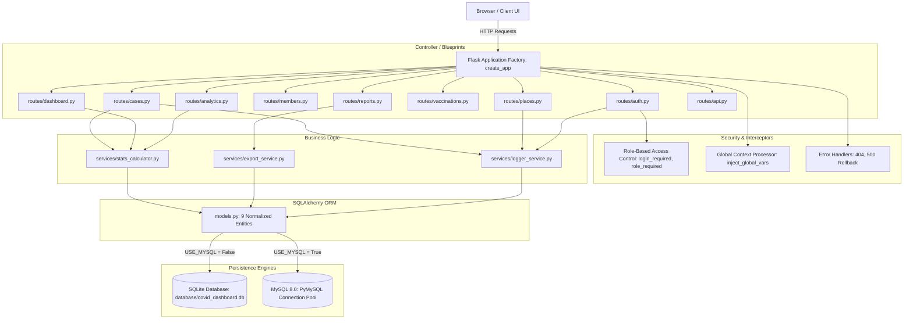
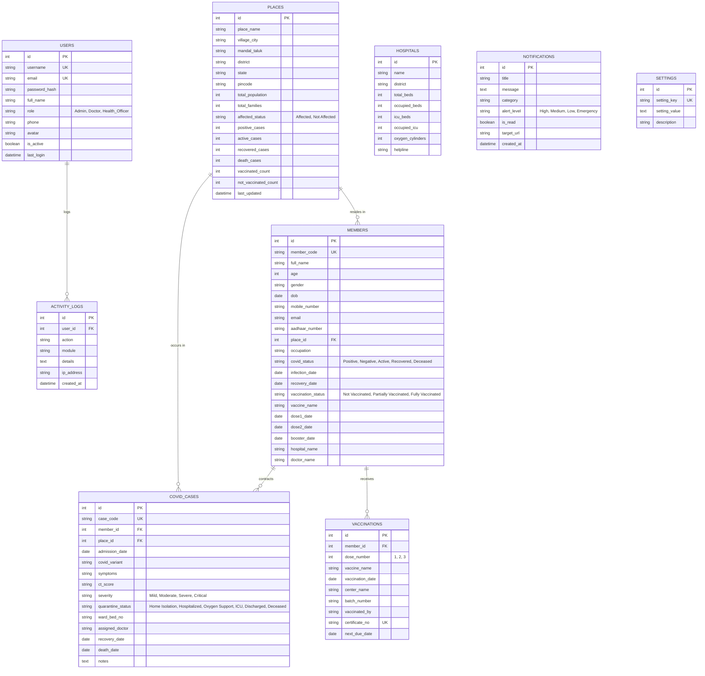
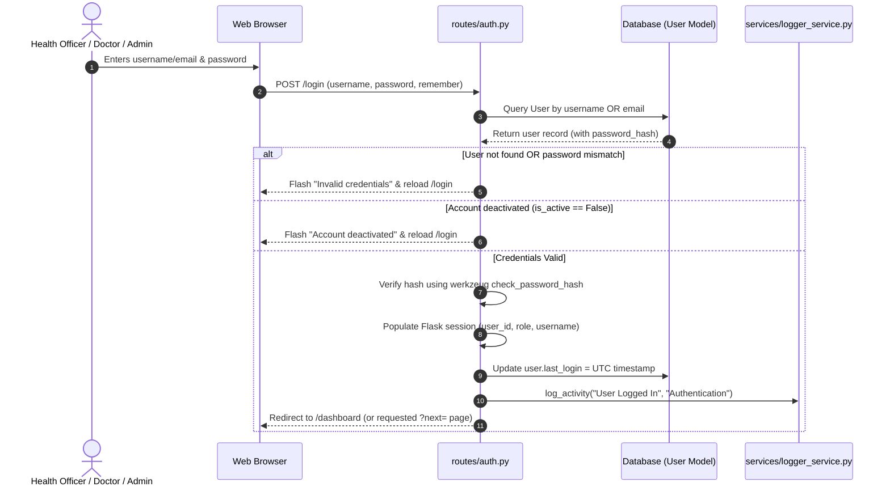
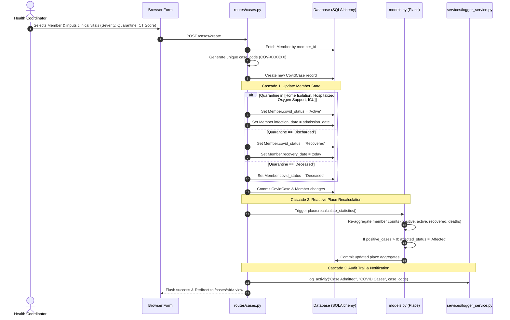
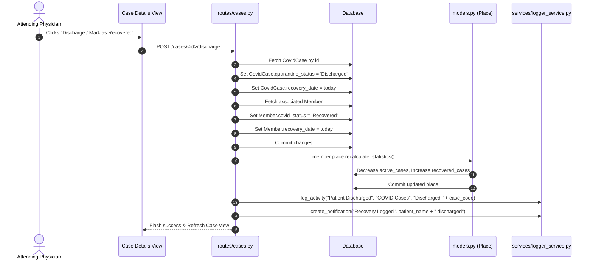
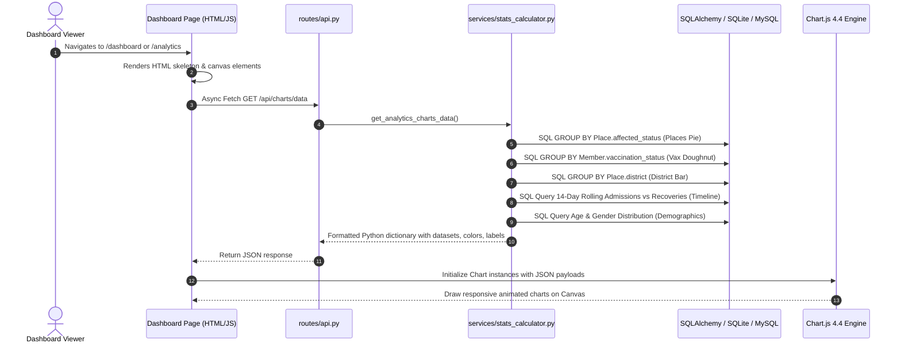
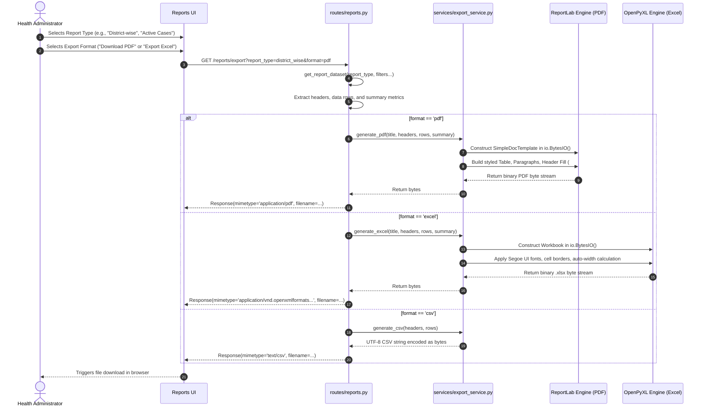

# 🦠 COVID-19 Health & Epidemiological Visualization Dashboard
## Comprehensive Project Documentation, Internal Architecture & System Workflows

> **Document Purpose:** This document provides an exhaustive, end-to-end technical and functional breakdown of the **COVID-19 Health & Epidemiological Visualization Dashboard**. It contains everything required to present, explain, demonstrate, and defend the project in academic vivas, technical interviews, client walkthroughs, and architecture reviews.

---

## 📑 Table of Contents
1. [Executive Summary & High-Level Pitch](#1-executive-summary--high-level-pitch)
2. [Problem Statement & Real-World Significance](#2-problem-statement--real-world-significance)
3. [Technology Stack & Architectural Rationale](#3-technology-stack--architectural-rationale)
4. [Internal System Architecture](#4-internal-system-architecture)
5. [Database Schema & Entity-Relationship (ER) Model](#5-database-schema--entity-relationship-er-model)
6. [Core Functional Modules & Features](#6-core-functional-modules--features)
7. [End-to-End System Workflows (With Sequence Diagrams)](#7-end-to-end-system-workflows-with-sequence-diagrams)
8. [Data Cascade & Automatic Synchronization Engine](#8-data-cascade--automatic-synchronization-engine)
9. [Reporting & Document Generation Engine (PDF, Excel, CSV)](#9-reporting--document-generation-engine-pdf-excel-csv)
10. [Frontend Design System & Aesthetics](#10-frontend-design-system--aesthetics)
11. [Annotated Directory & File Structure](#11-annotated-directory--file-structure)
12. [Installation, Setup & Deployment Guide](#12-installation-setup--deployment-guide)
13. [Project Presentation & Viva Masterclass (15 Key Q&As)](#13-project-presentation--viva-masterclass-15-key-qas)

---

## 1. Executive Summary & High-Level Pitch

### ⚡ The 30-Second Elevator Pitch
> *"The COVID-19 Health & Epidemiological Visualization Dashboard is an enterprise-grade public health surveillance and clinical intelligence system built with Python Flask, SQLAlchemy, Bootstrap 5.3, and Chart.js. It bridges the gap between field-level healthcare reporting and administrative decision-making by tracking citizen health records, automating quarantine triage, recalculating containment zone statistics in real time, monitoring critical hospital infrastructure (beds, ICUs, oxygen), and generating instant, production-ready PDF/Excel epidemiological reports."*

### 🎙️ The 2-Minute Deep Dive (For Presentations & Demonstrations)
During a health crisis, administrative and medical authorities struggle with three critical bottlenecks:
1. **Data Fragmentation:** Patient records, test results, hospital beds, and vaccination counts reside in disparate spreadsheets or siloed legacy systems.
2. **Lagged Epidemiological Intelligence:** Health officials cannot visualize outbreaks as they happen or identify containment zones dynamically when infections emerge in specific jurisdictions.
3. **Manual Reporting Overhead:** Generating daily government bulletins, district-wise case summaries, and vaccination audit spreadsheets wastes hundreds of manual hours.

This dashboard eliminates these bottlenecks through a **unified, multi-role web platform**:
- It tracks **Places** (villages, towns, taluks, districts) and **Members** (citizens).
- When a clinical case is registered, the system **automatically triggers a reactive data cascade**: updating the patient's health passport, recalculating the local place's infection metrics, adjusting containment status from *'Not Affected'* to *'Affected'*, and broadcasting real-time emergency notifications.
- It provides **12 animated KPI metric cards**, **5 epidemiological progress gauges** (Recovery Rate, Death Rate, Positivity Rate, Vaccination Coverage, Active Case Rate), and **7 interactive analytical charts** (including 14-day transmission trends, demographic pyramids, and hotspot bars).
- It features an export pipeline capable of compiling **11 distinct report types into styled, downloadable PDF and Excel documents** without requiring third-party cloud microservices.

---

## 2. Problem Statement & Real-World Significance

| Challenge in Traditional Pandemic Response | How This Dashboard Solves It |
| :--- | :--- |
| **Delayed Containment Zone Identification** | When positive cases are admitted, the application calculates positive thresholds and immediately marks the jurisdiction as **'Affected'**, displaying it on the emergency dashboard ticker. |
| **Spreadsheet Inaccuracies & Duplication** | Normalized relational database schema with unique member codes (`MEM-XXXXX`), case numbers (`COV-XXXXXX`), and vaccination certificates (`COV-VAX-XXXXX`). |
| **Hospital Resource Blindspots** | Real-time monitoring of general hospital beds, dedicated ICU beds, and oxygen cylinder reserves across all participating medical centers. |
| **Vaccination Certificate Forgery** | Tamper-evident digital vaccination certificates with calculated booster schedules, unique certificate hashes, and printable visual stamps. |
| **Inflexible Infrastructure Requirements** | **Dual-Engine Persistence:** Runs instantly with zero-configuration SQLite for edge/local deployments, and flips to high-throughput MySQL with connection pooling via a single environment variable. |

---

## 3. Technology Stack & Architectural Rationale

```
+-------------------------------------------------------------------------+
|                              CLIENT LAYER                               |
|   HTML5 + Vanilla CSS3 (Glassmorphism, Animations) + Bootstrap 5.3      |
|   Chart.js 4.4 (Canvas Data Viz) + Vanilla JS (DOM & Async Fetch)      |
+-------------------------------------------------------------------------+
                                    |
                                HTTP / REST
                                    v
+-------------------------------------------------------------------------+
|                        APPLICATION / ROUTING LAYER                      |
|                     Python 3.x + Flask 3.0+ Framework                   |
|  - 12 Modular Blueprints (auth, cases, places, members, analytics, etc) |
|  - Role-Based Access Control (RBAC) & Session Decorators                |
|  - Global Context Processors (Session state, notifications, branding)   |
+-------------------------------------------------------------------------+
                                    |
                                    v
+-------------------------------------------------------------------------+
|                           SERVICE LOGIC LAYER                           |
|  - StatsCalculator: Aggregate queries, KPI ratios, Chart.js formatters  |
|  - ExportService: Binary stream compilation (ReportLab PDF, OpenPyXL)   |
|  - LoggerService: System activity audit logs & emergency notifications  |
+-------------------------------------------------------------------------+
                                    |
                                    v
+-------------------------------------------------------------------------+
|                        DATA PERSISTENCE / ORM LAYER                     |
|                   SQLAlchemy 2.0 / Flask-SQLAlchemy 3.1                 |
|  - 9 Relational Models with Cascades, Foreign Keys, and B-Tree Indexes  |
|  - Dual Engine: SQLite (Local/Dev) <--> PyMySQL / MySQL 8.0 (Production)|
+-------------------------------------------------------------------------+
```

### Why These Specific Technologies Were Chosen:
1. **Python Flask (v3.0+)**:
   - Unlike heavy frameworks like Django that impose rigid monoliths, Flask provides a **micro-framework architecture** that allows explicit design of application factories, blueprint separation, and lightweight REST endpoints.
   - It integrates seamlessly with Python's scientific and reporting libraries (`reportlab`, `openpyxl`).

2. **SQLAlchemy 2.0 ORM**:
   - Provides database abstraction, parameterized query generation to guarantee **immunity against SQL Injection attacks**, and granular session management with transaction rollbacks on error.
   - Dual-engine configuration allows developers to test locally on SQLite without installing database servers, yet deploy to MySQL in production without altering a single line of model or query code.

3. **Chart.js 4.4**:
   - Modern, hardware-accelerated canvas chart rendering.
   - Allows seamless client-side chart-to-image export (`toBase64Image()`) for instant downloading of visual graphs.

4. **ReportLab 4.x & OpenPyXL 3.1+**:
   - Native in-memory Python PDF generation (`io.BytesIO`) using Flowables, TableStyles, and custom color palettes. It does **not** rely on slow headless browsers or external executables (like `wkhtmltopdf`).
   - OpenPyXL provides programmatic styling of Microsoft Excel spreadsheets (headers, fills, auto-column widths, and summary KPI rows).

---

## 4. Internal System Architecture

The application adopts the **Layered Architecture Pattern** combined with the **Service-Oriented Design Pattern** and Flask's **Application Factory Pattern**:



### Architectural Highlights:
- **Application Factory Pattern (`create_app` in `app.py`)**: Enables dynamic configuration switching (testing, development, production) and isolates application instances.
- **Modular Blueprint Organization**: Each domain module (e.g., `places`, `cases`, `vaccinations`, `reports`) is fully encapsulated with its own URL prefix, views, and template directory.
- **Context Processor (`inject_global_vars`)**: Automatically injects unread notification counts, latest alert items, custom application title, and the logged-in user object into every rendered Jinja2 template, eliminating duplicate queries across controllers.
- **Transactional Safety**: The application-level 500 error handler invokes `db.session.rollback()` automatically to prevent database locks or partially committed transactions during runtime exceptions.

---

## 5. Database Schema & Entity-Relationship (ER) Model

The database comprises **9 normalized entities** designed in **Third Normal Form (3NF)** with foreign key constraints, cascading rules, and B-tree indexes for fast analytical lookups.

### Database Tables Summary

| Table Name | Primary Purpose | Key Fields | Cascade Behavior |
| :--- | :--- | :--- | :--- |
| `users` | Staff & Admin accounts, authentication, RBAC | `id`, `username`, `email`, `password_hash`, `role` | Deleting a user deletes their activity logs (`cascade='all, delete-orphan'`) |
| `places` | Geographic jurisdictions & containment statistics | `id`, `place_name`, `district`, `affected_status`, `positive_cases` | Deleting a place sets `place_id` in members/cases to `NULL` |
| `members` | Citizen demographic & baseline health records | `id`, `member_code`, `full_name`, `mobile_number`, `place_id`, `covid_status` | Deleting a member cascades to delete their clinical cases and vaccinations |
| `covid_cases` | Clinical case history, triage, quarantine, HRCT | `id`, `case_code`, `member_id`, `severity`, `quarantine_status`, `admission_date` | Cascades deletion if parent member is deleted |
| `vaccinations` | Immunization doses, batch records, certificates | `id`, `certificate_no`, `member_id`, `dose_number`, `vaccine_name` | Cascades deletion if parent member is deleted |
| `hospitals` | Bed availability, ICU occupancy, oxygen reserves | `id`, `name`, `district`, `total_beds`, `occupied_beds`, `icu_beds`, `oxygen_cylinders` | Standalone reference entity |
| `notifications` | System-wide alerts, containment bulletins | `id`, `title`, `message`, `category`, `alert_level`, `is_read` | Broadcast entity |
| `activity_logs` | Immutable audit trail for compliance & tracking | `id`, `user_id`, `action`, `module`, `details`, `ip_address`, `created_at` | Retained even if user is deleted (`ondelete='SET NULL'`) |
| `settings` | Dynamic key-value runtime configuration store | `id`, `setting_key`, `setting_value`, `description` | System configuration |

---

### Entity-Relationship (ER) Diagram



---

## 6. Core Functional Modules & Features

### 1. 🔐 Authentication & Role-Based Access Control (RBAC)
- **Password Security**: Implemented with Werkzeug's `scrypt` cryptographic hashing (`generate_password_hash` and `check_password_hash`). Raw passwords are never stored in the database.
- **Session Lifecycle**: 30-day persistent cookie support when "Remember Me" is toggled; session clearing and activity logging on logout.
- **Granular Decorators**:
  - `@login_required`: Intercepts unauthenticated requests and redirects to login with a preservation query (`?next=...`).
  - `@role_required('Admin', 'Doctor')`: Restricts administrative operations (such as system configuration, user management, and broadcast alerts) strictly to authorized roles.

### 2. 📊 Animated 12-Card Dashboard & 5 KPI Rate Engines
The home dashboard computes and displays **12 core statistical counters** with ease-out JavaScript animations, coupled with **5 clinical health KPIs**:

$$\text{Recovery Rate (\%)} = \left(\frac{\text{Recovered Cases}}{\text{Total Positive Cases}}\right) \times 100$$

$$\text{Death Rate / Fatality Rate (\%)} = \left(\frac{\text{Deceased Cases}}{\text{Total Positive Cases}}\right) \times 100$$

$$\text{Positivity Rate (\%)} = \left(\frac{\text{Total Positive Members}}{\text{Total Monitored Members}}\right) \times 100$$

$$\text{Vaccination Coverage (\%)} = \left(\frac{\text{Fully Vaccinated Members}}{\text{Total Monitored Members}}\right) \times 100$$

$$\text{Active Case Ratio (\%)} = \left(\frac{\text{Active Cases}}{\text{Total Positive Cases}}\right) \times 100$$

> *Note:* All rate computations in `services/stats_calculator.py` include zero-division guard checks to ensure numeric safety when datasets are initialized.

### 3. 📈 Interactive Analytics Engine (Chart.js 4.4)
The analytics module renders **7 specialized epidemiological visualizations**:
1. **Affected vs Not Affected Places (Pie Chart)**: Containment ratio across monitored jurisdictions.
2. **Vaccination Breakdown (Doughnut Chart)**: Visual split between Fully Vaccinated, Partially Vaccinated, and Unvaccinated cohorts.
3. **District-Wise Epidemiological Matrix (Grouped Bar Chart)**: Multi-dataset comparison of Positive, Active, Recovered, and Deceased counts grouped by district.
4. **14-Day Transmission Timeline (Spline Area Chart)**: Chronological daily new positive cases vs. daily recoveries.
5. **Top Hotspot Jurisdictions (Horizontal Bar Chart)**: Ranked view of high-burden districts for priority medical resource allocation.
6. **Demographics Distribution (Pyramid Bar Chart)**: Age-bracket infection spread segmented by gender (0-17, 18-35, 36-50, 51-65, 65+).
7. **Vaccine Brand Market Share (Polar / Donut Chart)**: Distribution across Covishield, Covaxin, Sputnik V, Pfizer, and Moderna.

### 4. 🗺️ Place & Containment Management
- Full CRUD operations over geographic jurisdictions (Village/City, Mandal/Taluk, District, State, Pincode).
- Stores baseline demographic census (`total_population`, `total_families`).
- Features a **One-Click Aggregate Sync** that re-evaluates all members linked to the place and recalculates active, positive, recovered, and deceased counts on the fly.

### 5. 👥 Member Management & Digital Health Identity Card
- Tracks complete demographic and contact data (Name, Age, Gender, Mobile, Email, Aadhaar, Photo).
- Dynamically renders an official **Health Identity Card** showing live COVID status, vaccination badge, quarantine status, and attending physician details.

### 6. 🏥 COVID-19 Clinical Surveillance & Triage
- **Clinical Triage Grades**: Mild, Moderate, Severe, Critical.
- **Diagnostic Vitals**: HRCT CT Severity Score (e.g., `14/25`), active symptoms, SARS-CoV-2 variant (Delta, Omicron BA.5, etc.).
- **Quarantine Regimes**: Home Isolation, Hospitalized, Oxygen Support, ICU, Discharged, Deceased.
- **Bed & Resource Linkage**: Links directly to hospital wards and bed numbers.

### 7. 💉 Vaccination Drive & Verification System
- Supports Dose 1, Dose 2, and Booster administrations.
- Automatically calculates the next recommended vaccination window:
  - After Dose 1 $\rightarrow$ Sets next due date to $+84\text{ days}$ (12 weeks).
  - After Dose 2 $\rightarrow$ Sets next due date to $+180\text{ days}$ (6 months for booster eligibility).
- Generates a **unique, tamper-resistant digital vaccination certificate** with verification stamps and printable CSS styling.

### 8. 🔔 Emergency Alert Center & Audit Trail
- System-wide broadcast alerts with 4 priority levels (*Emergency*, *High*, *Medium*, *Low*).
- An interactive notification drawer that allows marking notifications as read individually or in bulk.
- Comprehensive `ActivityLog` records every user action (logins, creates, edits, deletes, alert broadcasts) with timestamp and client IP address.

---

## 7. End-to-End System Workflows (With Sequence Diagrams)

### Workflow 1: User Authentication & Access Verification
This workflow handles secure login, session initialization, and role verification for protected routes.



---

### Workflow 2: Patient Registration to Case Admission & Data Cascade
This workflow illustrates how registering a new COVID case automatically propagates updates across the member record, recalculates place statistics, and dispatches an emergency notification.



---

### Workflow 3: Case Recovery, Patient Discharge & Capacity De-escalation
When a patient recovers, this workflow demonstrates how discharging the patient frees clinical resources and rebalances geographical stats.



---

### Workflow 4: Real-Time Analytics Query & Chart.js Rendering Pipeline
This workflow explains how the client browser requests analytical data and renders interactive charts.



---

### Workflow 5: Report Generation & Multi-Format Binary Export Pipeline
This workflow demonstrates how administrative users compile complex queries into styled PDF, Excel, and CSV files in memory without temporary disk leaks.



---

## 8. Data Cascade & Automatic Synchronization Engine

One of the most powerful architectural features of this application is its **Reactive Aggregate Consistency Engine**. 

### The Problem of Stale Aggregates:
In naive implementations, when an administrator looks at a district or place summary, they see cached or manually entered counts that often contradict the actual records of patients residing in that place.

### The Solution (`Place.recalculate_statistics`):
Whenever any of the following events occur:
1. A new Member is registered or an existing Member is updated.
2. A new COVID Case is admitted.
3. A patient's quarantine status changes (e.g., from *Hospitalized* to *Discharged* or *Deceased*).
4. A member receives a vaccination dose.

The system immediately invokes:
```python
def recalculate_statistics(self):
    """Update aggregate counts from members associated with this place."""
    m_list = self.members
    self.positive_cases = sum(1 for m in m_list if m.covid_status in ['Positive', 'Active', 'Recovered', 'Deceased'])
    self.active_cases = sum(1 for m in m_list if m.covid_status in ['Positive', 'Active'])
    self.recovered_cases = sum(1 for m in m_list if m.covid_status == 'Recovered')
    self.death_cases = sum(1 for m in m_list if m.covid_status == 'Deceased')
    self.vaccinated_count = sum(1 for m in m_list if m.vaccination_status in ['Fully Vaccinated', 'Partially Vaccinated'])
    self.not_vaccinated_count = sum(1 for m in m_list if m.vaccination_status == 'Not Vaccinated')
    self.affected_status = 'Affected' if self.positive_cases > 0 else 'Not Affected'
    self.last_updated = datetime.utcnow()
```

### Why this is mathematically and architecturally superior:
- **Zero Inconsistency**: Place statistics reflect the exact sum of individual citizen states.
- **Dynamic Containment Zoning**: If all active cases in a village recover, and positive cases drop to zero, the zone transitions from *'Affected'* to *'Not Affected'* automatically.
- **Transactional Atomicity**: Both the member/case update and the place recalculation execute within the same SQLAlchemy unit of work, committing or rolling back together.

---

## 9. Reporting & Document Generation Engine (PDF, Excel, CSV)

The application includes an enterprise-level reporting subsystem supporting **11 distinct epidemiological reports**:
1. **Place-wise Health Summary**: Detailed containment breakdown of every monitored place.
2. **District-wise Epidemiological Report**: Macro-level overview by administrative district.
3. **Vaccination Coverage & Drive Report**: Immunization metrics and dose logs.
4. **Active COVID Cases & Inpatient Report**: Hospitalized and quarantined patients requiring immediate care.
5. **Patient Recovery & Discharge Report**: Historical log of cured patients.
6. **Mortality & Fatality Report**: Recorded deaths categorized by variant and comorbidity.
7. **Complete Member Directory**: Comprehensive citizen registry.
8. **Daily Surveillance Bulletin**: Today's snapshot of admissions and discharges.
9. **Weekly Epidemiological Review**: 7-day transmission trajectory.
10. **Monthly Containment Audit**: 30-day jurisdictional performance audit.
11. **Yearly Cumulative Overview**: Multi-quarter pandemic retrospective.

### Document Generation Technical Specs:
- **PDF Generation (`reportlab`)**:
  - Uses `SimpleDocTemplate` with `letter` and `landscape` orientations.
  - Custom `TableStyle` with corporate healthcare blue headers (`#1E3A8A`), alternating light-gray zebra stripes (`#F8FAFC`), gridlines (`#CBD5E1`), and automatic paragraph cell wrapping to prevent text clipping.
  - Written directly to an in-memory buffer (`io.BytesIO`), guaranteeing high throughput without creating temporary files on the server's hard drive.
- **Excel Generation (`openpyxl`)**:
  - Uses Microsoft Excel OpenXML standard (`.xlsx`).
  - Sets bold corporate headers, background fills, thin border grids, and automatically evaluates string lengths across all columns to dynamically adjust column widths (`ws.column_dimensions[col_letter].width = max_len + 3`).
- **CSV Streaming (`csv`)**:
  - Encoded with standard UTF-8 delimiters for seamless ingestion into Python Pandas, R, Tableau, or PowerBI.

---

## 10. Frontend Design System & Aesthetics

The user interface follows modern healthcare design best practices:

### 1. Curated Healthcare Color Palette
- **Medical Blue (`#0d6efd` / `#1e3a8a`)**: Primary brand identity, trust, and authority.
- **Health Teal (`#0d9488`)**: Vitality, recovery, and healthcare infrastructure.
- **Emerald Green (`#10b981`)**: Negative status, discharged patients, safe zones.
- **Warning Amber (`#f59e0b`)**: Moderate risk, partial vaccination, home isolation.
- **High-Risk Crimson (`#ef4444`)**: Critical ICU cases, positive outbreaks, deceased records.
- **Dark Slate (`#0f172a` / `#1e293b`)**: Ultra-modern, low-strain dark mode background.

### 2. Glassmorphism & Micro-Interactions
- Modals, header bars, and KPI cards leverage frosted glass aesthetics:
  ```css
  background: rgba(30, 41, 59, 0.7);
  backdrop-filter: blur(16px);
  -webkit-backdrop-filter: blur(16px);
  border: 1px solid rgba(255, 255, 255, 0.08);
  ```
- Subtle hover transforms (`translateY(-4px)`), smooth shadows, and ease-out transitions give the UI a responsive, tactile feel.

### 3. Ease-Out Counter Animations
All 12 KPI cards utilize a custom JavaScript easing function that counts up from 0 to the target metric when the dashboard loads:
```javascript
function animateCounter(element, target, duration = 1200) {
    let start = 0;
    const step = (timestamp) => {
        if (!startTime) startTime = timestamp;
        const progress = Math.min((timestamp - startTime) / duration, 1);
        const easeOutQuad = progress * (2 - progress);
        element.innerText = Math.floor(easeOutQuad * target).toLocaleString();
        if (progress < 1) requestAnimationFrame(step);
    };
    requestAnimationFrame(step);
}
```

### 4. Seamless Dark / Light Mode Switcher
- Stores user preference in browser `localStorage`.
- Automatically synchronizes toggle switches across all views without page flickers.

---

## 11. Annotated Directory & File Structure

```
COVID 19 DASHBOARD/
│
├── app.py                      # Application Factory: initializes Flask, DB, extensions, blueprints & global context processor
├── config.py                   # Configuration class: handles secret keys, uploads, and MySQL vs SQLite dual-engine logic
├── models.py                   # Normalized SQLAlchemy models (User, Place, Member, CovidCase, Vaccination, Hospital, etc.)
├── init_db.py                  # Database Seeder: drops/creates schema and populates 65+ members, 15 places, and mock records
├── run.py                      # Lightweight server launcher (entry point for 'python run.py')
├── requirements.txt            # Python dependencies (Flask, SQLAlchemy, PyMySQL, ReportLab, OpenPyXL, Pillow)
├── test_app.py                 # Automated test suite (9 comprehensive unit/integration test cases)
│
├── database/                   # Database scripts & storage
│   ├── covid_dashboard.db      # SQLite local database file (zero-configuration development)
│   ├── schema.sql              # Clean MySQL/MariaDB database schema DDL script
│   ├── seed_data.sql           # SQL insert statements for initial mock dataset
│   └── covid_dashboard_full.sql# Complete combined schema & seed dump for production MySQL import
│
├── routes/                     # Blueprint controllers (Modular route handlers)
│   ├── __init__.py             # Route package initializer
│   ├── auth.py                 # Authentication, login, logout, password reset, RBAC decorators
│   ├── dashboard.py            # Main executive dashboard view and widget controllers
│   ├── places.py               # Places CRUD, district filtering, containment status management
│   ├── members.py              # Citizens/Members CRUD, health profile, search & age filters
│   ├── cases.py                # COVID clinical cases, admission, triage, severity & discharge
│   ├── vaccinations.py         # Immunization records, dose tracking & digital certificate display
│   ├── analytics.py            # Advanced visualization & Chart.js analytics page
│   ├── reports.py              # Report generation engine (11 reports) and export dispatchers
│   ├── notifications.py        # Broadcast alerts, unread counters, mark-as-read endpoints
│   ├── profile.py              # User account profile, avatar upload, and password update
│   ├── settings.py             # System settings, title configuration, alert thresholds, audit logs
│   └── api.py                  # JSON REST endpoints for charts, summary stats, and autocomplete
│
├── services/                   # Business logic layer (Decoupled from HTTP routes)
│   ├── stats_calculator.py     # Aggregates KPI rates, demographic pyramids, 14-day trends, hotspot bars
│   ├── export_service.py       # In-memory document compilers: ReportLab (PDF), OpenPyXL (Excel), CSV
│   └── logger_service.py       # Audit trail logger and notification dispatch helper
│
├── static/                     # Frontend static assets
│   ├── css/
│   │   ├── style.css           # Primary application stylesheet & layout rules
│   │   ├── dark-mode.css       # Complete dark theme styling variables and overrides
│   │   ├── glassmorphism.css   # Frosted glass, backdrop-filter, and card sheen effects
│   │   └── animations.css      # Keyframes for pulse, fade, slide, and badge glows
│   ├── js/
│   │   ├── main.js             # Global utilities, alert dismissals, modal handling
│   │   ├── dashboard.js        # KPI card number increment animations & refresh logic
│   │   ├── charts.js           # Chart.js initialization, datasets, tooltips, PNG image exporter
│   │   ├── export.js           # Client-side print formatting & download triggers
│   │   └── theme.js            # Light/Dark mode localStorage toggle controller
│   └── uploads/                # User avatar images and uploaded health documents
│
└── templates/                  # Jinja2 HTML templates
    ├── base.html               # Master layout (sidebar, top navbar, global notifications, footer)
    ├── auth/                   # login.html, forgot_password.html
    ├── dashboard/              # index.html (12 cards, live marquee, summary charts, hospital beds)
    ├── places/                 # list.html (place directory), form.html (CRUD), view.html (place details)
    ├── members/                # list.html, form.html, view.html (digital health identity card)
    ├── cases/                  # list.html, form.html, view.html (case file, symptoms, triage)
    ├── vaccinations/           # list.html, form.html, certificate.html (printable vaccine passport)
    ├── analytics/              # index.html (7 high-resolution charts & district tables)
    ├── reports/                # index.html (report viewer, format selector, date pickers), print.html
    ├── notifications/          # index.html (emergency broadcast board, alert filters)
    ├── profile/                # index.html (profile settings, activity history)
    ├── settings/               # index.html (system config, threshold sliders, activity logs)
    └── errors/                 # 404.html (not found), 500.html (internal server error)
```

---

## 12. Installation, Setup & Deployment Guide

### Prerequisites
- Python 3.10, 3.11, or 3.12 installed on your system.
- Git (optional, for cloning).
- Modern web browser (Chrome, Edge, Firefox, Safari).

### Step 1: Clone or Navigate to the Project Directory
```powershell
cd "c:\Users\kmani\OneDrive\Pictures\Desktop\COVID 19 DASHBOARD"
```

### Step 2: Create and Activate a Virtual Environment
```powershell
# Create virtual environment
python -m venv venv

# Activate on Windows PowerShell:
.\venv\Scripts\Activate.ps1

# (Or on Command Prompt):
.\venv\Scripts\activate.bat
```

### Step 3: Install Required Dependencies
```powershell
pip install -r requirements.txt
```

### Step 4: Initialize and Seed the Database
The project comes pre-bundled with an initialized SQLite database in `database/covid_dashboard.db`. If you wish to reset or re-seed it with fresh data:
```powershell
python init_db.py
```
*Output: Drops tables, creates fresh schema, and seeds users, hospitals, places, members, cases, vaccinations, notifications, and settings.*

### Step 5: Run Automated Unit Tests (Verification)
Run the test suite to verify that all 9 critical components are functioning properly:
```powershell
python test_app.py
```
*Expected Result:*
```
Ran 9 tests in ~11s
OK
```

### Step 6: Start the Application
```powershell
python run.py
```
Open your browser and navigate to: **`http://localhost:5000`**

---

### Dual-Database Configuration (SQLite vs MySQL)

The application automatically defaults to **SQLite** (`database/covid_dashboard.db`), requiring zero database installation.

To switch to enterprise **MySQL / MariaDB** (e.g., in XAMPP, WAMP, or cloud MySQL):
1. Create a MySQL database:
   ```sql
   CREATE DATABASE covid19_dashboard CHARACTER SET utf8mb4 COLLATE utf8mb4_unicode_ci;
   ```
2. Set the environment variables in your terminal:
   ```powershell
   $env:USE_MYSQL = "True"
   $env:MYSQL_HOST = "localhost"
   $env:MYSQL_PORT = "3306"
   $env:MYSQL_USER = "root"
   $env:MYSQL_PASSWORD = "your_mysql_password"
   $env:MYSQL_DB = "covid19_dashboard"
   ```
3. Run `python init_db.py` to create and seed all tables in your MySQL instance.
4. Launch the application: `python run.py`.

---

### Default Login Credentials

| Role | Username | Password | Access Privileges |
| :--- | :--- | :--- | :--- |
| **Chief Health Officer (Admin)** | `admin` | `admin123` | Full system access: places, members, cases, vaccinations, reports, system settings, alert broadcast |
| **Medical Specialist (Doctor)** | `doctor` | `doctor123` | Clinical case management, severity grading, patient triage, discharge processing, vaccination logs |
| **Field Health Worker (Staff)** | `staff` | `staff123` | Citizen registration, place monitoring, vaccine registration, report viewing |

---

## 13. Project Presentation & Viva Masterclass (15 Key Q&As)

Use this section to prepare for presentations, client walkthroughs, university vivas, and technical interviews.

---

### Q1: What is the core problem your application solves?
**Answer:**
> *"During public health crises like COVID-19, decision-makers face fragmented citizen data, delayed reporting of local infection clusters, and manual compilation of administrative reports. Our system centralizes epidemiological surveillance: it tracks citizens, clinical cases, and vaccines, automatically updates containment zone metrics in real time, monitors hospital bed and oxygen capacity, and compiles official PDF and Excel reports with a single click."*

---

### Q2: Why did you choose Flask over Django or Node.js?
**Answer:**
> *"We chose Flask because of its lightweight, micro-framework architecture. Unlike Django, which imposes heavy monolithic conventions, Flask gave us complete freedom to structure an explicit multi-layer architecture with 12 modular blueprints and custom service layers (`StatsCalculator`, `ExportService`, `LoggerService`). Additionally, Python's rich ecosystem made it straightforward to integrate native PDF generation via ReportLab and Excel styling via OpenPyXL without external microservices."*

---

### Q3: How do you maintain data consistency between individual patients and place statistics?
**Answer:**
> *"We avoid the risk of stale aggregated data by implementing a Reactive Aggregate Cascade pattern. In our `Place` model, we have a `recalculate_statistics()` method. Whenever a patient is admitted, discharged, or passes away, this method automatically re-queries the place's associated members, recalculates active, positive, recovered, and deceased numbers, and transitions the zone's status from 'Not Affected' to 'Affected' (or vice-versa). Both the patient record and the updated place aggregates commit atomically within the same SQLAlchemy database transaction."*

---

### Q4: How is security handled in your system?
**Answer:**
> *"Security is implemented across multiple layers:*
> 1. *Password Hashing: We use Werkzeug's cryptographic `scrypt` hashing with unique salts, ensuring passwords are never stored in plain text.*
> 2. *SQL Injection Protection: All database interactions utilize SQLAlchemy ORM with parameterized queries, preventing malicious SQL injection.*
> 3. *Role-Based Access Control (RBAC): We implemented custom Python decorators (`@login_required` and `@role_required`) to prevent unauthorized access to sensitive endpoints.*
> 4. *Session Security: Cookie sessions are signed with a cryptographically secure `SECRET_KEY` and support configurable lifetimes.*
> 5. *File Upload Validation: User avatars and uploads are filtered against an extension whitelist and sanitized using `secure_filename` to prevent path traversal attacks."*

---

### Q5: How does your dual-database engine work?
**Answer:**
> *"In `config.py`, we implemented a flexible configuration switch controlled by the `USE_MYSQL` environment variable. If `USE_MYSQL` is False, SQLAlchemy connects to a zero-configuration SQLite database file stored in `database/covid_dashboard.db`. If `USE_MYSQL` is True, it dynamically constructs a PyMySQL connection string with MySQL connection pooling (`pool_recycle=280`, `pool_pre_ping=True`). Because all models use standard SQLAlchemy ORM abstractions, the entire codebase operates identically across both engines without modifying a single line of business logic."*

---

### Q6: How does your PDF generation work without headless Chrome or wkhtmltopdf?
**Answer:**
> *"Many web applications rely on external tools like `wkhtmltopdf` or headless Puppeteer browsers, which are slow, memory-intensive, and difficult to deploy. We implemented pure Python vector PDF compilation using `ReportLab 4.x`. In `ExportService.generate_pdf()`, we build document flowables (paragraphs, tables, spacer elements) inside an in-memory byte buffer (`io.BytesIO()`), apply custom corporate color palettes and table grids, and stream the resulting binary data directly to the client with `mimetype='application/pdf'`. This produces professional, lightweight PDFs in under 200 milliseconds."*

---

### Q7: What are the 5 clinical health KPIs calculated by your dashboard, and why are they important?
**Answer:**
> *"Our system calculates:*
> 1. *Recovery Rate (%): Proportion of infected patients who have been cured and discharged. Measures medical efficacy.*
> 2. *Death / Case Fatality Rate (%): Mortality ratio among positive cases. Measures disease virulence and system strain.*
> 3. *Positivity Rate (%): Positive tests divided by total screened population. Key epidemiological indicator for community transmission.*
> 4. *Vaccination Coverage (%): Fully vaccinated members over total census. Measures herd immunity progress.*
> 5. *Active Case Ratio (%): Active cases currently under clinical care versus total historical cases. Indicates current hospital burden."*

---

### Q8: How does the dashboard prevent division by zero in KPI calculations when there is no data?
**Answer:**
> *"In `services/stats_calculator.py`, every rate formula is protected by explicit conditional ternary guards. For instance, the recovery rate is evaluated as: `round((recovered_members / positive_members * 100), 1) if positive_members > 0 else 0.0`. This guarantees the application never throws a `ZeroDivisionError` during fresh database initializations."*

---

### Q9: How does the Global Context Processor improve code maintainability?
**Answer:**
> *"In Flask, templates often require global information such as the logged-in user's name, unread notification counts, and application branding. Instead of manually querying these in all 12 controllers and passing them into every `render_template` call, we registered an `@app.context_processor` in `app.py`. This processor injects `current_user`, `unread_notif_count`, `recent_notifs`, and `app_title` into the global Jinja2 execution context across the entire web application automatically."*

---

### Q10: How do the animated counter cards work on the frontend?
**Answer:**
> *"In `static/js/dashboard.js`, each metric card has a `data-target` attribute holding its numerical value. When the DOM finishes loading, an animation script uses `requestAnimationFrame` and an easing equation (`easeOutQuad`) to smoothly increment numbers from zero to the target value over 1.2 seconds. This creates a polished, dynamic experience for executive viewers."*

---

### Q11: How does your digital vaccination passport work?
**Answer:**
> *"When a vaccination is recorded, the system verifies the dose number. If Dose 1 is registered, the citizen's status becomes 'Partially Vaccinated' and the system automatically calculates a recommended Dose 2 date 84 days later. When Dose 2 is completed, the status updates to 'Fully Vaccinated' and a 180-day booster window is established. The system generates a cryptographically unique certificate number (e.g., `COV-VAX-81688`) and renders a printable, official certificate layout with verification stamps."*

---

### Q12: How is the hospital bed and oxygen monitor integrated?
**Answer:**
> *"We maintain a `Hospital` entity tracking total beds, occupied beds, ICU units, occupied ICUs, and oxygen cylinders across districts. In `services/stats_calculator.py`, the system aggregates bed occupancy percentages and ICU occupancy rates. If ICU occupancy exceeds warning thresholds, health officers can immediately prioritize resource transfers."*

---

### Q13: What is the purpose of the Activity Log?
**Answer:**
> *"Public health data requires strict governance and accountability. Our `ActivityLog` entity acts as an immutable audit trail. Every time a user logs in, creates a place, edits a patient file, or broadcasts an emergency notification, `LoggerService.log_activity()` captures the action, the affected module, a human-readable description, the user's ID, and their client IP address."*

---

### Q14: How does Chart.js handle dynamic data from Flask?
**Answer:**
> *"We decoupled data generation from presentation. Our Flask API route `/api/charts/data` returns structured JSON objects containing labels, datasets, and hex color codes generated by `StatsCalculator`. On the frontend, `static/js/charts.js` fetches this JSON asynchronously and binds it to Chart.js canvas elements. Each chart includes a 'Download PNG' button that converts the canvas rendering directly into an image blob using `canvas.toDataURL('image/png')`."*

---

### Q15: If you had 6 more months, how would you scale this application to handle 10 million citizens?
**Answer:**
> *"To scale this application to a state or national population of 10 million+:*
> 1. *Caching Layer: Introduce Redis to cache frequent dashboard summaries and Chart.js payloads with 60-second invalidation, eliminating heavy database aggregate queries.*
> 2. *Asynchronous Task Queue: Implement Celery with RabbitMQ or Redis to offload PDF compilation, batch CSV exports, and email/SMS alerts to background worker pools.*
> 3. *Database Sharding & Read Replicas: Implement MySQL read-replicas for reporting queries and shard citizen tables by geographic district.*
> 4. *Geospatial Integration: Integrate PostGIS / Leaflet.js to render choropleth polygon heatmaps directly on interactive district maps.*
> 5. *Containerization & Autoscaling: Dockerize the application and deploy with Kubernetes (GKE or AWS EKS) behind an NGINX reverse proxy with Gunicorn WSGI workers."*

---

## 🎯 Summary Checklist for Presenters

When presenting this project to an evaluator, follow this structure:
1. **Show the Login Screen**: Explain password hashing, RBAC roles (`Admin`, `Doctor`, `Staff`), and the 'Remember Me' feature.
2. **Explore the Dashboard**: Highlight the 12 animated counter cards, the 5 KPI rate gauges, the emergency containment ticker, and the hospital bed monitor.
3. **Toggle Dark / Light Mode**: Demonstrate the glassmorphism design system and CSS transitions.
4. **Demonstrate Data Cascading**:
   - Open a Place (e.g., *Green Valley Colony*). Note its positive and active cases.
   - Register a new citizen residing in that place.
   - Admit that citizen as a COVID case.
   - Return to the Place: show that active cases increased and the place status automatically updated to *'Affected'*.
   - Mark the patient as *'Discharged'*: show the place's active count decrease and recovery count increase.
5. **Showcase the Analytics View**: Review the 14-day timeline, demographic pyramid, and export a chart as a PNG image.
6. **Download Reports**: Generate both a **PDF** and an **Excel** report on the fly to prove the in-memory binary export engine works.
7. **Display the Vaccine Certificate**: Open a vaccinated member and show their official printable digital vaccine passport.
8. **Conclude with Architecture & Viva Points**: Walk through the layered architecture diagram, ER diagram, and address scalability.
